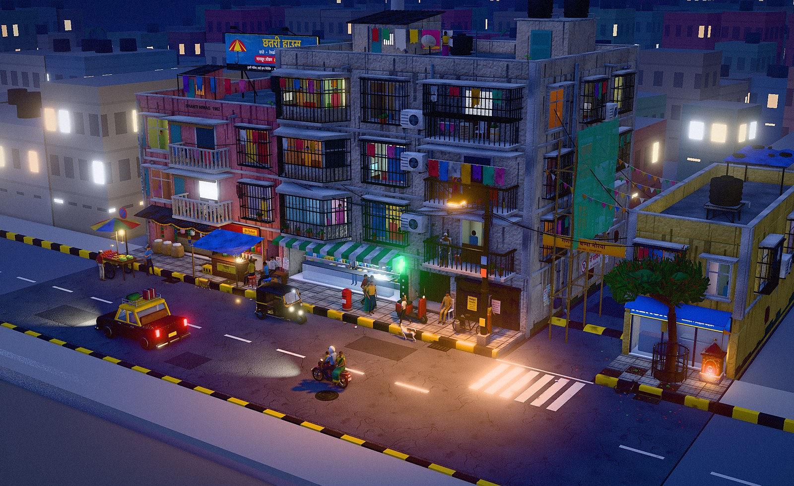
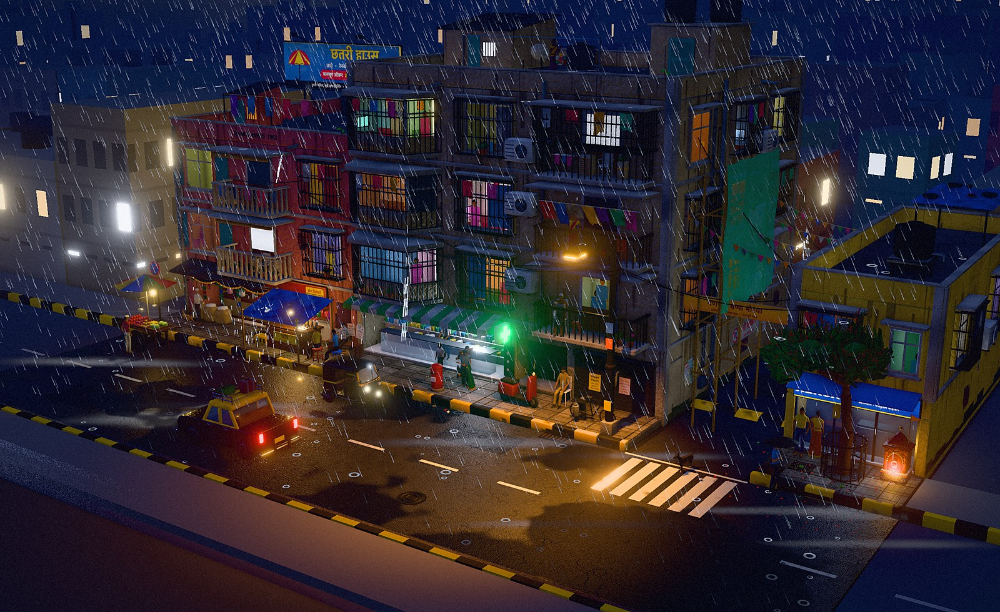
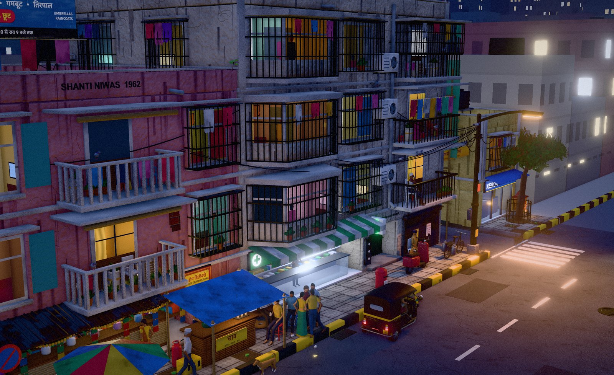

# Monsoon Corner

**A Mumbai street corner you can push from a quiet night into a monsoon downpour.**
A little Blender model of one stretch of a Mumbai street, brought into the browser with three.js, where
everything on it lives: the rain, the light, the people, the animals and the city around it.







It opens at night. Drag **Time** back towards noon, push **Rain** up to a downpour, or press
**Bring the monsoon** and let it roll in. Drag to look around, scroll to zoom, and click things on the
street to read about them.

Or press **Stories** and watch one of two short films played on the street itself:

- **Light gayi.** A stormy night in July, and the power goes. Candles and phone torches come on behind
  the windows, the kirana switches on its battery light, one flat with an inverter keeps its TV going,
  and then the lights come back on, one home at a time.
- **The first rain.** A hot afternoon at the end of May. The cloud comes in, the pigeons go up, the cat
  leaves, aunty runs for her washing, and everyone ends up under the same tarpaulin.

## Run it

```bash
npm install
npm run dev      # http://localhost:5173
npm run build    # a static site in dist/
```

## What's happening on the street

**Weather and light**
- Night by default, through to a hard noon: sun, sky, skylight, the bounce off the street, haze and
  white balance blend through keyframes (noon, golden hour, a pink sunset, a lavender blue hour, a
  moonlit night). Windows come on house by house as it gets dark; shop signs, the stall bulb and the
  sodium streetlight with them.
- Rain that knows what's overhead: it stops on roofs, awnings, the chai tarp and the tree, drips off
  every chajja and balcony, runs off the tarp's edges, pours out of the roof pipes (landing with a
  crown of spray, a churn of white water and a sheet running off), and fills the road with puddles
  whose reflections ripple under each drop. Lightning and thunder in a heavy night storm.
- Surfaces darken and turn glossy as they soak, and dry slowly after.

**People**
- Seven passers-by run errands along the footpath; when the rain comes they run for cover, one hand
  over their head, then step out to look up and hold a palm out, and go back in if it's still coming.
- Gully cricket in the side lane with a real ball (drag, bounces, the speed breaker's hump): the
  bowler's arm windmills over, the batsman times his swing, sometimes the stumps fly. They play on in
  the rain and go home at dusk.
- A family of three on one motorbike (mum side-saddle in her saree, the kid on the tank), leaning into
  the turn as they overtake the taxi.
- Uncle on his balcony in a banian and checked lungi, sipping cutting chai and watching the street. Up
  on the roof, the aunty rushes her washing in when the rain starts and pegs it all back up once it's dry.
- Chaiwala and his regulars, the kirana shopkeeper, the pharmacist, the watchman at the gate.

**Animals**
- Street dogs that roam, sniff, sit and sunbathe, trot off to shelter in the rain and shake themselves
  dry after; one sleeps under the chai bench through everything.
- A ginger cat on the scooter seat who washes her face, flicks her ears, and leaps down to wait out
  the rain on the gate step.
- Kabootar: a flock of pigeons pecking at grain and sitting on every ledge and wire, bursting up to wheel
  round the block when a dog trots in, and huddling under the chajjas in the rain.

**The city around it**
- Behind every window pane there's a room (interior mapping): walls, an almirah, a tube light, a fan,
  people moving about, TVs flickering.
- The block is one stretch of a longer street: the road and lane carry on into a procedural Mumbai of
  chawls, blue-tarp roofs, water tanks, palms, a temple and a mosque, towers with cranes on the
  horizon and the Queen's Necklace along the bay at night, all fading into the humid haze.
- Signs in Hindi and English: shop boards, a rooftop hoarding, the Ganpati banner, a painted tuition ad.

## How it's made

The street is a Blender model: the buildings and shops, the chai tapri, the people, the dogs, cat and
pigeons, the auto and the taxi, down to the handbills on the walls. It's exported from Blender as glTF
(`.glb` files in `public/models/`, with compressed geometry and WebP textures), and three.js loads it
in the browser. The Blender files themselves are in `blender/`: open one, change it, and export it over
its `.glb` (File > Export > glTF 2.0, glTF Binary, with Custom Properties, Apply Modifiers and
Compression on, since the app reads the custom properties), then refresh. Everything that happens on it is done there, in JavaScript:

- **Hooks in the model.** Some objects, empties and materials are named so the app knows what to do
  with them: a `light_` empty becomes a real light, a `glow_` material lights up at night, a `spout_`
  pours in the rain, a `perch` is a ledge pigeons can sit on (the full list is below).
- **Animated in code.** The people and animals are posed on simple pivots (hips, knees, shoulders,
  elbows, neck; legs, tail and head for the animals) and animated live rather than playing baked
  clips, so they can react: walking and running gaits, the bowler's arm, uncle's sip of chai, a dog's
  walk and trot, the cat's leap, pigeons taking off.
- **A shelter map.** Once the street loads it's rendered once from straight above into a float target
  holding the height of the first surface at each point. Rain, steam, puddles, water landings, people,
  dogs, the cat and the pigeons all use it to know what's overhead and where it's dry.
- **Rooms in the glass.** Each window is one quad whose shader traces the view ray on into a box room
  behind it, so every room has real depth and parallax, with its own colours, furniture, lighting and
  sometimes someone walking across.
- **A city in a few draw calls.** The city around the block is generated in the browser and drawn
  instanced, with haze, windows and weathering worked out per pixel; anything that would come between
  the camera and the street dissolves out of the way.
- **Small physics everywhere.** Gravity and drag for rain, spray and the cricket ball; damped springs
  for washing, tarp and tree; a motorbike that leans at atan(a / g); a pouring stream that lands where
  its arc takes it.
- **Rendering.** Multisampled frame, ground-truth ambient occlusion, bloom for the night lights,
  Beer–Lambert haze, a sky-gradient environment map, and a light film grade.

The signs are artwork, not 3D text: Devanagari needs proper shaping (a vowel sign like ि is stored after
its consonant but drawn before it, and conjuncts need ligatures), so the boards, banners and handbills are
typeset as images and mapped onto the model.

## From Blender to the browser

The names in the Blender file that the app looks for when the model loads:

| In Blender | In the app |
|---|---|
| `spot_<story>` empty | its children open that card from `src/stories.js` |
| `sway_<axis>_…` | swings in the wind around its origin (washing, tarp, tree crown) |
| `light_…` empty | a real light is placed there (stall bulb, shop tubes, streetlight) |
| `steam_kettle` empty | where the chai steam rises |
| `drip…` empty | a drop falls from here every so often in the rain (chajja and balcony edges) |
| `spout_…` empty | water pours out of it in the rain (its local +X is the way the water leaves) |
| `glow_…` material | lights up at night; `glow_win1`…`glow_win6` switch on in batches as dusk falls |
| `…_wNN` material | darkens and gets damp in the rain, by NN % |
| `wheel_…` (vehicles) | spins when the taxi drives |
| `ped_<n>` (pedestrians) | a passer-by; joints `leg_l/r`, `knee_l/r`, `arm_l/r`, `elbow_l/r`, `head` turn about their local Z (+ forward, a knee bends with −, an elbow with +, the head tips up with +; heads also turn about Y) |
| `leg_l/r`, `knee_l/r`, `arm_l`, `umbrella` (walker) | joints the app walks (each turns about its local Z; + swings forward, a knee bends with −); the umbrella shows in the rain |
| `edge_…` empty | a point on a roof sheet's edge where runoff leaves; `w` = its share. Its parent is the roof (with `area` and `pool`) |
| `fan_…` empty with `rpm` | an AC fan; spins about its own Blender Z (out of the wall) |
| `perch` empty | a ledge or wire the pigeons sit along; extras `a`, `b` (its ends), `sag`, `nx`, `ny` (which way they face) and `kind` (chajja, sill, rail, parapet, ac, wire, board) |
| `room` empty | the middle of a window pane; extras `w`, `h`, `nx`, `ny` (which way it faces) and `kind` (its glass: `glow_win1`…`6`, `glow_tv` or `glass_dark`). `src/rooms.js` draws the room behind it |
| `uncle`, `aunty`, `wash_<n>`, `roof_door`, `aunty_bundle`, `aunty_bucket` (neighbours) | the two figures have `arm_l/r`, `elbow_l/r` and `head` pivots like the walkers; the washing, the door, her armful and bucket are moved by the app |

The vehicles load into their own slots (`src/models.js`): the auto waits at the kerb by the chai
stall and the taxi drives through the near lane (India drives on the left), slipping in and out
of the block's cut edges via clipping planes.

## Physics (`src/physics.js`)

Everything is scaled to the model: one storey (3 m) is 1.3 units, so 1 unit ≈ 2.3 m and gravity is
4.2 units/s².

- **Rain** falls at terminal velocity (8–9.5 m/s by drop size), drifts with the wind, and its streak
  length is the distance a drop covers while a 1/22 s shutter is open.
- **Shelter map.** Once the street loads, it's rendered once from straight above into a float target
  that stores the height of the first surface below each point. Rain stops there and splashes: on
  roofs, tanks, awnings, the chai tarp, the tree, the parked auto. Nothing falls under cover.
- **Impacts.** Landing water leaves an expanding ring and sometimes a crown of droplets that fly
  ballistically. Spouts, ledge drips, the taxi's rear tyres (spray thrown up and back on a wet
  road) and the walker's footsteps all use the same system.
- **Wind.** One gusty wind drives the rain slant, mist, steam and everything that sways. The washing,
  the tarp, the flag and the tree crown are damped springs with their own natural frequencies, so
  they lean into gusts, overshoot and settle.
- **Gait.** Walking ~1.8 steps/s and running ~2.8 (about 3.4 m/s), with stride and joint swing
  scaling with speed: hips swing wider, knees fold to clear the ground, elbows bend to ~90° and the
  body leans into a run; people accelerate and brake within human limits and turn at a finite rate.
- **Motion.** Taxi wheels roll without slipping (ω = v / r). The walker walks at about 1.3 m/s, about
  1.8 steps a second, with a gait cycle: the hip swings ~25° forward and ~10° back, the knee bends a
  little as the foot takes the weight and ~60° in the swing to clear the ground, the free arm swings
  against the opposite leg, the body rides highest over the standing leg, and a heel strike on a wet
  road splashes under that heel.
- **Light** falls off with the inverse square of distance (bulb, tube lights, diya, lantern,
  streetlight, headlights).
- **Haze** follows Beer–Lambert: light from a surface fades as e^(−d/L) over the distance it travels
  through wet air, with d measured from the front of the block so zooming doesn't fog the street.
  L goes from ~3 km of visibility on a humid clear day to ~350 m in a monsoon downpour, so the back of
  the block greys a little and the front keeps its colour.
- **Overcast light.** Rain cloud takes the sun (no hard shadows) but the whole sky still glows, so
  skylight goes up a little and the exposure adapts like an eye would. Reflections come from the
  actual sky gradient (rebuilt as time and weather change), not from a studio room.
- **Wet surfaces** get darker *and* richer, not greyer: water fills the rough surface so less light
  scatters back white (albedo^(1+0.6·wetness)), and they turn glossy.
- **Steam** puffs are buoyant parcels: the lift fades as they mix with cooler air and drag ties them to
  the air around. Under the chai tarp (found from the shelter map) a puff is pressed against the
  underside, spreads out from where it hit, creeps uphill along the sheet and spills over the edge
  before it rises again.
- **Runoff.** The chai tarp and the shop awnings are small reservoirs. Rain and the roof spout that pours
  onto the tarp fill them; the tarp's sag holds a shallow pool first, then water leaves over every edge
  (most at the low front, most of all in the middle where the sag drains) with a ~1.4 s time constant,
  and falls under gravity to the footpath. After the rain stops the tarp keeps dripping for a while.
- **Spouts** throw water out at ~0.55 units/s; where it lands is found by following the arc (fall time
  √(2h/g)), not by looking straight down.
- **AC fans** cycle on and off with their compressors, spinning up and down with the rotor's inertia.
  They're shown at a few hundred rpm: the real ~800 would strobe at 60 fps (the wagon-wheel effect).

## Project layout

```
public/models/      the Blender model, exported as .glb
blender/            the Blender files (.blend, one per model) and the sign artwork (signs/*.png)
src/
  main.js           scene, lighting, time of day, post-processing, the frame loop
  world.js          loads the street and wires up what its names mean
  physics.js        wind, shelter map, rain, impacts, swaying things
  weather.js        steam, wet road, spouts and splashes, drips, runoff, sound
  crowd.js, cricket.js, bike.js, dogs.js, cat.js, pigeons.js, neighbours.js
  rooms.js          rooms behind the windows;  city.js: the city around the block
  tales.js          the two stories: their shots, weather, captions and cues
  director.js       plays a story: camera, timeline, captions;  power.js: what a power cut does
  looks.js          optional art styles (?look=toy|ink|gouache|pixel|riso)
```

## Deploy

`npm run build` writes a static site to `dist/`. On Netlify or any static host: build command
`npm run build`, publish directory `dist`.

## Licence

The code is under the [MIT licence](LICENSE). The model and artwork (the Blender files, the exported
models, the sign artwork and the screenshots) are © Aarya Rajgor under
[CC BY-NC 4.0](LICENSE-ASSETS): share and adapt them with credit, but not commercially.
